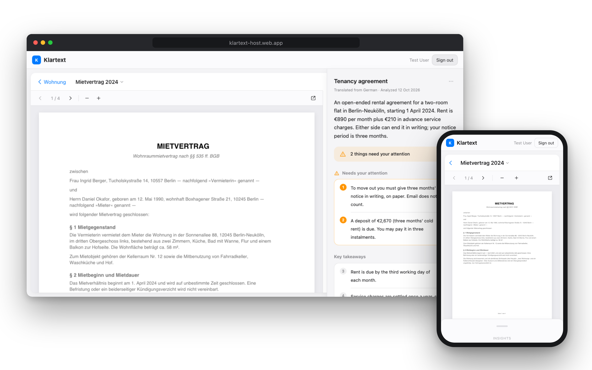
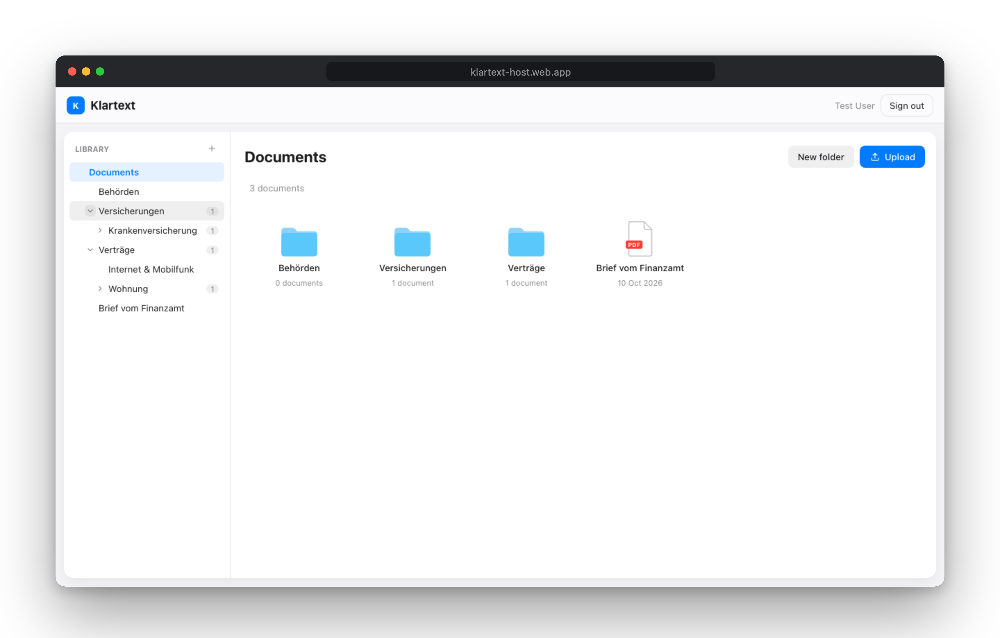

# KlartextDMS

A personal filing cabinet for German paperwork that explains each document in plain English.

Moving to Germany means a flood of contracts and official letters: Mietvertrag, Krankenversicherung, Internetvertrag, Behördenbriefe. Klartext stores them and, for each one, produces an **Extraction**: the document type, an English summary, the key takeaways (amounts, dates, obligations), and the **Action Items** (notice periods, deadlines, hidden fees) that cost you money or rights if you miss them.

[](https://github.com/JohnNooney/KlartextDMS/actions/workflows/firebase-hosting-merge.yml)
[](./LICENSE)

Live at [klartext.nooney.dev](https://klartext.nooney.dev). Sign-in is allowlist-gated.





## Try it yourself

Requires Node 24 and pnpm 9.

```sh
git clone https://github.com/JohnNooney/KlartextDMS.git && cd KlartextDMS
pnpm install
pnpm dev:demo
```

Open http://localhost:4200 and sign in with `test-user@test.com` / `test1234` (emulator only). The seeded Documents open with their Extractions already filled in, and `dev:demo` swaps the AI provider for deterministic fixtures, so no API keys are needed. Plain `pnpm dev` calls the real Gemini model and needs Firebase credentials (see [development internals](./docs/development.md)).

## How it works

Klartext is also a sandbox for an enterprise integration problem: embedding a newly acquired Vue product inside a legacy Angular dashboard when the only integration point is an `<iframe>`. So it is two independent frontends that talk **only** over `window.postMessage`: no Module Federation, no Web Components.

| | Host | Guest |
|---|---|---|
| Stack | Angular 21, SCSS | Vue 3.5, Vite 8, Tailwind 4 |
| Role | Sign-in, library, uploads, PDF reader, the frame the Guest renders in | Extraction panel; calls the AI |
| Dev port | :4200 | :5173 |

- **The Bus.** Everything crossing the iframe is an Envelope `{ v, type, sessionId, payload }`, defined in [`packages/bus-contract`](./packages/bus-contract). The Host queues Extractions as background jobs after upload and opens a Session (`INIT_SESSION`) when a Document is clicked; the Guest reports progress back while you keep browsing.
- **Platform.** Firebase end to end: Hosting (two sites), Auth, App Check, Storage for Document bytes, Firestore for metadata and Extractions, and Firebase AI Logic (Gemini) called from the Guest with the PDF sent directly to the model. Local development runs on the Firebase emulators. One Extraction per Document is persisted and reused.

Domain terms (Host, Guest, Document, Extraction, Action Item, Bus, Envelope, Session, ...) are defined in [`CONTEXT.md`](./CONTEXT.md).

## Status

v1 is shipped: sign-in, folder library, uploads, the reader, and persisted Extractions. v2 is in progress: the Extraction v2 schema, Action Items, and the Host extraction index are done; library search, calendar reminders, and per-page Translation are planned. See [`docs/spec.md`](./docs/spec.md).

## Repository layout

```
apps/host           Angular dashboard
apps/guest          Vue insights panel rendered in the Host's iframe
packages/           shared theme tokens, Bus contract, Firebase config
e2e/                Playwright suite and screenshot composites
scripts/            emulator seed, fixtures, build helpers
emulator-data/      committed emulator snapshot
docs/               documentation, ADRs, spec
firebase.json, firestore.rules, storage.rules   Firebase config and security rules
```

## Common commands

```sh
pnpm dev          # Host + Guest + Auth/Firestore/Storage emulators (seeded)
pnpm dev:demo     # same, with fixture Extractions instead of Gemini
pnpm typecheck
pnpm test         # unit suites across the workspace
pnpm e2e          # Playwright under the emulators
pnpm screenshots  # regenerate docs/screenshots/*.png
```

## Further reading

The [documentation index](./docs/README.md) covers [architecture](./docs/architecture.md), [ADRs](./docs/adr/), [deployment](./docs/deployment.md), and [development internals](./docs/development.md) (ports, e2e wiring, App Check tokens, the full script list).

Contributing: issues live in GitHub Issues (see [`docs/agents/issue-tracker.md`](./docs/agents/issue-tracker.md)); agent conventions are in [`AGENTS.md`](./AGENTS.md).

## License

[MIT](./LICENSE)
